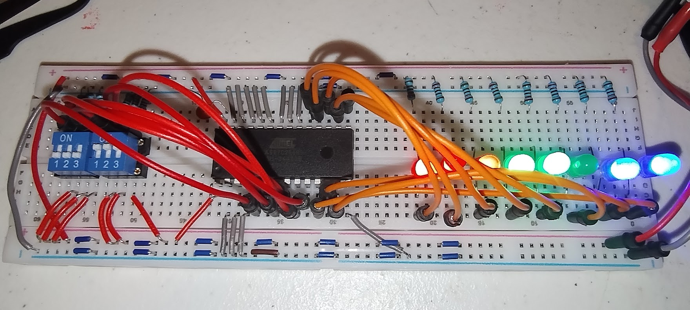

# AT27C256R color PROM

This bench passes. The switch code selects a kit row, and the LEDs show that packed byte.



One kit chip in the socket at a time. The package is 600 mil, in a 28-pin socket. Power is off while the chip goes in or comes out.

Notch up. Pin 1 is the top pin on the left.

Connection lines use the chains in [bench-color-bars.md](bench-color-bars.md).

```text
ICs

PROM, AT27C256R

      +---\_/---+
  VPP | 1    28 | VCC
  A12 | 2    27 | A14
   A7 | 3    26 | A13
   A6 | 4    25 | A8
   A5 | 5    24 | A9
   A4 | 6    23 | A11
   A3 | 7    22 | OE#
   A2 | 8    21 | A10
   A1 | 9    20 | CE#
   A0 | 10   19 | O7
   O0 | 11   18 | O6
   O1 | 12   17 | O5
   O2 | 13   16 | O4
  GND | 14   15 | O3
      +----+----+

+5 V <--> Switch 5 <--> 5 (PROM) <--> (10 kohm) <--> GND
+5 V <--> Switch 4 <--> 6 (PROM) <--> (10 kohm) <--> GND
+5 V <--> Switch 3 <--> 7 (PROM) <--> (10 kohm) <--> GND
+5 V <--> Switch 2 <--> 8 (PROM) <--> (10 kohm) <--> GND
+5 V <--> Switch 1 <--> 9 (PROM) <--> (10 kohm) <--> GND
+5 V <--> Switch 0 <--> 10 (PROM) <--> (10 kohm) <--> GND
+5 V <--> (2.2 kohm) <--> red LED bit 7 <--> 19 (PROM)
+5 V <--> (2.2 kohm) <--> red LED bit 6 <--> 18 (PROM)
+5 V <--> (2.2 kohm) <--> red LED bit 5 <--> 17 (PROM)
+5 V <--> (2.2 kohm) <--> green LED bit 4 <--> 16 (PROM)
+5 V <--> (2.2 kohm) <--> green LED bit 3 <--> 15 (PROM)
+5 V <--> (2.2 kohm) <--> green LED bit 2 <--> 13 (PROM)
+5 V <--> (2.2 kohm) <--> blue LED bit 1 <--> 12 (PROM)
+5 V <--> (2.2 kohm) <--> blue LED bit 0 <--> 11 (PROM)
+5 V <--> 1 (PROM), 28 (PROM)
GND <--> 2 (PROM), 3 (PROM), 4 (PROM), 14 (PROM), 20 (PROM) through 27 (PROM)
28 (PROM) <--> (100 nF) <--> 14 (PROM)

Switch 0 is the rightmost. Closed is 1. Left to right on the board, bit 0 is the rightmost LED. The LED anode faces the resistor. A lit LED is a 0. A dark LED is a 1.
```

A high on A14 selects the upper 16 KB. Those bytes are `0xFF`. CE# or OE# high turns the data pins off.

## Check

The switch code, left to right, is the kit row in [`video-graphics.md`](../video-graphics.md), starting at 0. Switch 5 is the left bit.

The output byte is read left to right. Bit 0 is the rightmost LED.

| Pin | Byte bit |
| --- | --- |
| 19 | 7 |
| 18 | 6 |
| 17 | 5 |
| 16 | 4 |
| 15 | 3 |
| 13 | 2 |
| 12 | 1 |
| 11 | 0 |

| A5 to A0 | Row | O7 to O0 |
| --- | --- | --- |
| 000000 | 0 | 00000000 |
| 000001 | 1 | 00100000 |
| 000100 | 4 | 00100100 |
| 001100 | 12 | 00000001 |
| 010000 | 16 | 00100101 |
| 100000 | 32 | 10010010 |
| 110000 | 48 | 11111111 |
| 111111 | 63 | 11110011 |

Power off, then the second chip goes in with the notch at the same end. The same switches light the same LEDs.
