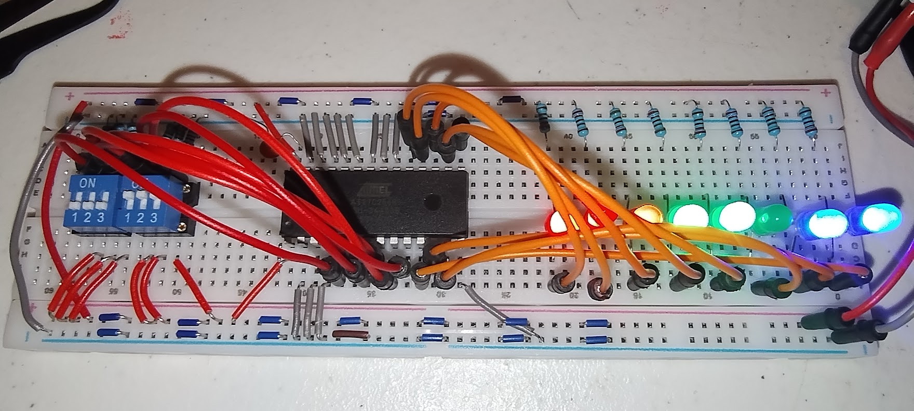

# AT27C256R color PROM

This bench passes. The switch code selects a kit row, and the LEDs show that packed byte.



One kit chip in the socket at a time. The package is 600 mil, in a 28-pin socket. Power is off while the chip goes in or comes out.

Notch up. Pin 1 is the top pin on the left.

```text
ICs

PROM, AT27C256R

      +---\_/---+
  VPP | 1    28 | VCC
  A12 | 2    27 | A14
   A7 | 3    26 | A13
   A6 | 4    25 | A8
   A5 | 5    24 | A9
   A4 | 6    23 | A11
   A3 | 7    22 | OE#
   A2 | 8    21 | A10
   A1 | 9    20 | CE#
   A0 | 10   19 | O7
   O0 | 11   18 | O6
   O1 | 12   17 | O5
   O2 | 13   16 | O4
  GND | 14   15 | O3
      +----+----+

wires

The data wire lands on the LED cathode.
Left to right on the board. Bit 0 is the rightmost LED.
19 (PROM) goes to red LED bit 7
18 (PROM) goes to red LED bit 6
17 (PROM) goes to red LED bit 5
16 (PROM) goes to green LED bit 4
15 (PROM) goes to green LED bit 3
13 (PROM) goes to green LED bit 2
12 (PROM) goes to blue LED bit 1
11 (PROM) goes to blue LED bit 0

Address switches. Switch 0 is the rightmost.
5 (PROM) goes to Switch 5
6 (PROM) goes to Switch 4
7 (PROM) goes to Switch 3
8 (PROM) goes to Switch 2
9 (PROM) goes to Switch 1
10 (PROM) goes to Switch 0

passives, rails, connectors

+5 V goes to 1 (PROM), 28 (PROM)
GND goes to 2 (PROM), 3 (PROM), 4 (PROM), 14 (PROM), 20 (PROM) through 27 (PROM)
(100 nF) goes to 28 (PROM), 14 (PROM)

Address switch. Closed is 1. Open is held at 0 by 10 kohm to GND. The other side of the switch is +5 V.

LED. +5 V, then 2.2 kohm, then the anode. A lit LED is a 0. A dark LED is a 1.
```

A high on A14 selects the upper 16 KB. Those bytes are `0xFF`. CE# or OE# high turns the data pins off.

## Check

The switch code, left to right, is the kit row in [`video-graphics.md`](../video-graphics.md), starting at 0. Switch 5 is the left bit.

The output byte is read left to right. Bit 0 is the rightmost LED.

| Pin | Byte bit |
| --- | --- |
| 19 | 7 |
| 18 | 6 |
| 17 | 5 |
| 16 | 4 |
| 15 | 3 |
| 13 | 2 |
| 12 | 1 |
| 11 | 0 |

| A5 to A0 | Row | O7 to O0 |
| --- | --- | --- |
| 000000 | 0 | 00000000 |
| 000001 | 1 | 00100000 |
| 000100 | 4 | 00100100 |
| 001100 | 12 | 00000001 |
| 010000 | 16 | 00100101 |
| 100000 | 32 | 10010010 |
| 110000 | 48 | 11111111 |
| 111111 | 63 | 11110011 |

Power off, then the second chip goes in with the notch at the same end. The same switches light the same LEDs.
