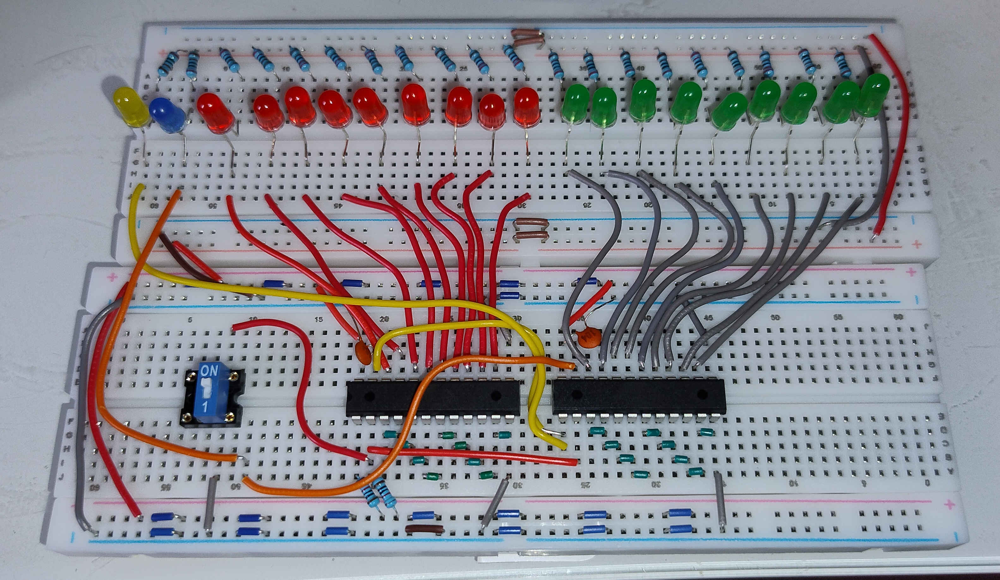

# Beam X and Beam Y

Both counters are 9 bits, Q0 through Q8. Q0 is pin 14. Each next bit is the next pin, through Q8 on pin 22. HSYNC and VSYNC are pin 23. The count checks below passed on an earlier image whose outputs were scattered across those pins. Burn `beam_x.jed` and `beam_y.jed` again and move the LED wires onto the pins in this note. The red LEDs show the Beam X count and the green LEDs show the Beam Y count. Several tests have been performed (Note: the GND and 5V cables swapped at the top-right are a small hack, don't mind that).



Two ATF22V10C parts, already burned, on a breadboard. Beam X counts dots 0 through 340. Beam Y counts lines 0 through 261. One frame is 262 of those lines. The images are [`beam_x.jed`](../../../apps/flasher_tool/firmware/a/beam_x.jed) and [`beam_y.jed`](../../../apps/flasher_tool/firmware/a/beam_y.jed).

The package is 300 mil. Each chip sits in a 24-pin socket of that width. The notch is pin 1. Power is off while a chip goes in or comes out. Both chips are in the sockets for a frame.

One HiLetgo CH340 module clocks the counters and feeds 5 V. It is a 6-pin USB serial header: 5V, VCC, 3V3, TXD, RXD, GND. The 5V pin is USB power. The VCC pin powers the CH340, and TXD swings at whatever voltage reaches VCC. The yellow jumper stays off. The 5V pin and the VCC pin each get a wire to the +5 V rail. The 3V3 pin and RXD stay open.

Twenty LEDs. Along each chip, from pin 14 up to pin 23: Q0, Q1, Q2, Q3, Q4, Q5, Q6, Q7, Q8, then the sync pin. Beam X bits are red and HSYNC is yellow. Beam Y bits are green and VSYNC is blue. The pin drives the LED anode through 2 kohm or 2.2 kohm. The cathode goes to ground. A lit LED is 1. A dark LED is 0. Q0 is the least significant bit.

## Parts

| Part | Qty | Role |
| --- | --- | --- |
| ATF22V10C, PDIP-24, Beam X image | 1 | Dot counter. HSYNC high on counts 264 through 288 |
| ATF22V10C, PDIP-24, Beam Y image | 1 | Line counter. VSYNC high on counts 243 through 245 |
| 24-pin socket, 300 mil | 2 | One per PLD |
| 100 nF | 2 | One per chip, from V+ to the ground rail |
| 10 kohm | 2 | One on the shared RES wire. One on Beam X pin 1 |
| Switch | 1 | One switch on the shared RES wire. Closed holds both counters at 0 |
| HiLetgo CH340 module | 1 | Clock and 5 V. TXD drives Beam X pin 1. RXD stays open |
| LED | 20 | One yellow, one blue, nine red, nine green, in that left-to-right order |
| 2 kohm or 2.2 kohm | 20 | One from each pin to the LED anode. Cathode to ground. Both values suit yellow, blue, red, and green |

## Place

| Mark | Pins | Where |
| --- | --- | --- |
| V+ | pin 24, one on each chip | The two pin 24s share the +5 V rail. The CH340 5V pin and the CH340 VCC pin both land on that rail |
| C | one cap on each chip | From that chip's V+ to the ground rail |
| GD | pins 3 through 13 on each chip | These pins share the ground rail |
| RS | pin 2, one on each chip | The two pin 2s share one wire. One 10 kohm from that wire to +5 V. One switch from that wire to ground |
| CK | Beam X pin 1 only | One 10 kohm from this pin to +5 V. CH340 TXD on this pin |
| HS | Beam X pin 23 and Beam Y pin 1 | Yellow. These two pins share one wire. Resistor from that wire to the anode. Cathode to ground |
| Q0 | pin 14, one on each chip | Red on Beam X, green on Beam Y, bit 0 |
| Q1 | pin 15, one on each chip | Bit 1 |
| Q2 | pin 16, one on each chip | Bit 2 |
| Q3 | pin 17, one on each chip | Bit 3 |
| Q4 | pin 18, one on each chip | Bit 4 |
| Q5 | pin 19, one on each chip | Bit 5 |
| Q6 | pin 20, one on each chip | Bit 6 |
| Q7 | pin 21, one on each chip | Bit 7 |
| Q8 | pin 22, one on each chip | Bit 8 |
| VS | Beam Y pin 23 only | Blue. Resistor from this pin to the anode. Cathode to ground |

```text
 Clock
  yellow jumper off
  5V ---- +5V rail
  VCC ---- +5V rail
  GND ---- GND rail
  RXD open
  3V3 open

 CK is Beam X pin 1 only
  10 kohm ---- +5 V
  TXD ---- this pin

 RS is one shared wire
  Beam X pin 2 ---- Beam Y pin 2
  10 kohm ---- +5 V
  switch ---- ground

 HS is one shared wire
  Beam X pin 23 ---- Beam Y pin 1
  HSYNC LED: resistor from this wire to the anode, cathode to ground

 VSYNC LED: resistor from Beam Y pin 23 to the anode, cathode to ground

 +5V ---- CH340 5V, CH340 VCC
              Beam X                              Beam Y
               notch                               notch
            +----U-----+                        +----U-----+
         CK |  1    24 | V+                  HS |  1    24 | V+
         RS |  2    23 | HS                  RS |  2    23 | VS
         GD |  3    22 | Q8                  GD |  3    22 | Q8
         GD |  4    21 | Q7                  GD |  4    21 | Q7
         GD |  5    20 | Q6                  GD |  5    20 | Q6
         GD |  6    19 | Q5                  GD |  6    19 | Q5
         GD |  7    18 | Q4                  GD |  7    18 | Q4
         GD |  8    17 | Q3                  GD |  8    17 | Q3
         GD |  9    16 | Q2                  GD |  9    16 | Q2
         GD | 10    15 | Q1                  GD | 10    15 | Q1
         GD | 11    14 | Q0                  GD | 11    14 | Q0
         GD | 12    13 | GD                  GD | 12    13 | GD
            +----------+                        +----------+
         C is one 100 nF on each chip, from V+ to the ground rail
 GND ---- CH340 GND
```

Only the CH340 feeds 5 V. On that module, RXD and 3V3 stay open.

## Check

`./ic_verifier 2 --clock` holds TXD low while the reset switch is closed. After the switch opens, TXD rises 10 times a second. `./ic_verifier 2 --clock --hz 2` is the same clock at another rate.

Each rising edge adds one Beam X count. Count 341 is count 0 again. One line is 341 edges. At 10 Hz that line takes 34.1 seconds. HSYNC rises on the edge that enters 264, and that rise adds one Beam Y count. Beam Y is already 1 while Beam X finishes the line and wraps to 0. The next HSYNC rise is 341 Beam X edges later.

A frame is 262 lines. At 10 Hz that is about 2.5 hours. Line 262 wraps Beam Y to 0.

A lit LED is 1. Beam X, in count order:

| Edges | Count | Q1 | Q0 | HSYNC |
| --- | --- | --- | --- | --- |
| 0 | 0 | 0 | 0 | 0 |
| 1 | 1 | 0 | 1 | 0 |
| 2 | 2 | 1 | 0 | 0 |
| 3 | 3 | 1 | 1 | 0 |
| 4 | 4 | 0 | 0 | 0 |
| 264 | 264 | 0 | 0 | 1 |
| 288 | 288 | 0 | 0 | 1 |
| 289 | 289 | 0 | 1 | 0 |
| 341 | 0 | 0 | 0 | 0 |

HSYNC is high on counts 264 through 288. Q8 through Q2 follow the same count. Count 256 is Q8 alone. Count 340 is Q8, Q6, Q4, and Q2.

Beam Y, counted in HSYNC rises:

| HSYNC rises | Count | Q1 | Q0 | VSYNC |
| --- | --- | --- | --- | --- |
| 0 | 0 | 0 | 0 | 0 |
| 1 | 1 | 0 | 1 | 0 |
| 2 | 2 | 1 | 0 | 0 |
| 3 | 3 | 1 | 1 | 0 |
| 243 | 243 | 1 | 1 | 1 |
| 245 | 245 | 0 | 1 | 1 |
| 246 | 246 | 1 | 0 | 0 |
| 262 | 0 | 0 | 0 | 0 |

VSYNC is high on counts 243 through 245. Count 256 is Q8 alone. Count 261 is Q8, Q2, and Q0.
