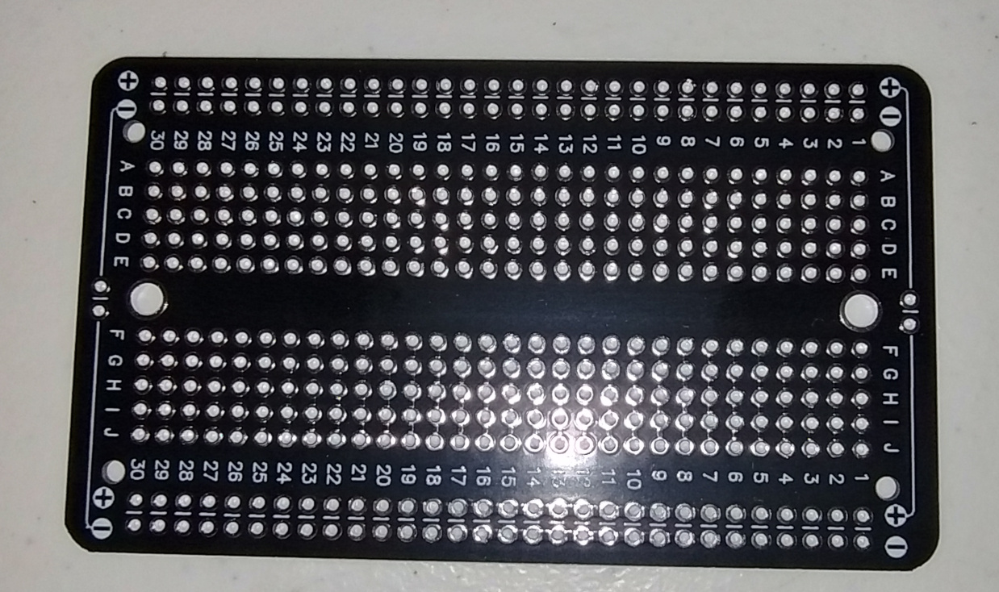

# Color bars on a CRT

This bench is not passed yet. Eight vertical bars on an RGBS CRT. Four perma-proto boards. Beam X, Beam Y, and the PROM are the burned chips from the passing notes. These boards have no LEDs. The compositor, the VRAM, the CPU, and the CXA2075M stay off these boards. Power is off while a chip goes in.



Each module is one board like the photo. 30 rows, columns A through J, power rails along both edges.

The +5 V rail on every board is CH340 5V and CH340 VCC. The GND rail on every board is CH340 GND. Yellow jumper off. RXD, 3V3, and TXD stay open.

Notch up. Pin 1 is the top pin on the left. A pin with no wire and no passive is open.

Headers are single-row pins soldered on the boards. The first name in a header list is the top pin with the notch up. Names in [brackets] are inputs. Names in (parentheses) are outputs. A name in both is written [(name)]. GND is the return. This bench has no pin that is both. The Kycon KMDGX-9S-AS is absent from this bench. A single-row header on the RGBS board carries the CRT wires.

Connection lines use `A <--> B <--> C`.

`A <--> B` joins A and B.

Each name with a neighbor on both sides is read against those two neighbors. A 2-leg part sits in series. One leg lands on the left neighbor and the other leg lands on the right neighbor. A resistor, a capacitor, a crystal, a switch, and an LED are 2-leg parts. A pin or a header pin is one tie. Both neighbors land on that pin.

A comma list is a fanout onto the first name, not a chain through the listed names. `+5 V <--> 14 (U04), 14 (U74)` ties each listed name to +5 V.

A number is an IC pin. `5, 6, 7` are pins 5, 6, and 7. The `(part)` after a number, a comma list, or a range names the chip. `5 (PROM)` is pin 5 of the PROM. `2, 3, 4 (PROM)` is pins 2, 3, and 4 of the PROM. `3 through 11 (Beam X)` is pins 3 through 11 of Beam X. Pin lists run from the low pin to the high pin.

One pin name, header name, or rail name is one net on every line. A 2-leg part with a designator, such as R13 or C1, is that same part on every line. A 2-leg part written only as a value is a new part on each line.

```text
1. Clock

U04, 74HCU04

      +---\_/---+
   1A | 1    14 | VCC
   1Y | 2    13 | 6A
   2A | 3    12 | 6Y
   2Y | 4    11 | 5A
   3A | 5    10 | 5Y
   3Y | 6     9 | 4A
  GND | 7     8 | 4Y
      +----+----+

U74, SN74HC74

       +---\_/---+
 1CLR# | 1    14 | VCC
    1D | 2    13 | 2CLR#
  1CLK | 3    12 | 2D
 1PRE# | 4    11 | 2CLK
    1Q | 5    10 | 2PRE#
   1/Q | 6     9 | 2Q
   GND | 7     8 | 2/Q
       +----+----+

header

(DOT) - GND

1 (U04) <--> Y2 (21.47727 MHz) <--> 2 (U04)
1 (U04) <--> R24 (1 Mohm) <--> 2 (U04)
1 (U04) <--> C21 (22 pF) <--> GND
2 (U04) <--> C22 (22 pF) <--> GND
2 (U04) <--> 3 (U04)
4 (U04) <--> 3 (U74)
2 (U74) <--> 6 (U74)
5 (U74) <--> 11 (U74)
8 (U74) <--> 12 (U74)
9 (U74) <--> R13 (33 ohm) <--> (DOT)
+5 V <--> 14 (U04), 1, 4, 10, 13, 14 (U74)
GND <--> 5, 7, 9, 11, 13 (U04), 7 (U74)
14 (U04) <--> C1 (100 nF) <--> 7 (U04)
14 (U74) <--> C2 (100 nF) <--> 7 (U74)
```

U04, U74, Y2, R13, and the (DOT) header share this one board. Pins 5, 9, 11, and 13 of U04 are unused inputs.

```text
2. Beams

Beam X, ATF22V10C          Beam Y, ATF22V10C

      +---\_/---+                 +---\_/---+
  CLK | 1    24 | VCC         CLK | 1    24 | VCC
  RES | 2    23 | HSYNC       RES | 2    23 | VSYNC
  GND | 3    22 | Q8          GND | 3    22 | Q8
  GND | 4    21 | Q7          GND | 4    21 | Q7
  GND | 5    20 | Q6          GND | 5    20 | Q6
  GND | 6    19 | Q5          GND | 6    19 | Q5
  GND | 7    18 | Q4          GND | 7    18 | Q4
  GND | 8    17 | Q3          GND | 8    17 | Q3
  GND | 9    16 | Q2          GND | 9    16 | Q2
  GND | 10   15 | Q1          GND | 10   15 | Q1
  GND | 11   14 | Q0          GND | 11   14 | Q0
  GND | 12   13 | GND         GND | 12   13 | GND
      +----+----+                 +----+----+

Beam X header

[DOT] - GND - (XQ0) - (XQ1) - (XQ2) - (XQ3) - (XQ4) - (XQ5) - (XQ6) - (XQ7) - (XQ8) - (HSYNC)

Beam Y header

GND - (YQ0) - (YQ1) - (YQ2) - (YQ3) - (YQ4) - (YQ5) - (YQ6) - (YQ7) - (YQ8) - (VSYNC)

1 (Beam Y) <--> 23 (Beam X) <--> (HSYNC)
2 (Beam Y) <--> 2 (Beam X) <--> switch <--> GND
+5 V <--> (10 kohm) <--> 2 (Beam X)
+5 V <--> (10 kohm) <--> 1 (Beam X) <--> [DOT]
14 (Beam X) <--> (XQ0)
15 (Beam X) <--> (XQ1)
16 (Beam X) <--> (XQ2)
17 (Beam X) <--> (XQ3)
18 (Beam X) <--> (XQ4)
19 (Beam X) <--> (XQ5)
20 (Beam X) <--> (XQ6)
21 (Beam X) <--> (XQ7)
22 (Beam X) <--> (XQ8)
14 (Beam Y) <--> (YQ0)
15 (Beam Y) <--> (YQ1)
16 (Beam Y) <--> (YQ2)
17 (Beam Y) <--> (YQ3)
18 (Beam Y) <--> (YQ4)
19 (Beam Y) <--> (YQ5)
20 (Beam Y) <--> (YQ6)
21 (Beam Y) <--> (YQ7)
22 (Beam Y) <--> (YQ8)
23 (Beam Y) <--> (VSYNC)
+5 V <--> 24 (Beam X), 24 (Beam Y)
GND <--> 3 through 13 (Beam X), 3 through 13 (Beam Y)
24 (Beam X) <--> C3 (100 nF) <--> 12 (Beam X)
24 (Beam Y) <--> C4 (100 nF) <--> 12 (Beam Y)
```

The switch, closed, holds both counters at 0. Pins 3 through 11 and pin 13 are unused inputs on each chip. The color-bar cable uses XQ7, XQ6, XQ5, HSYNC, and VSYNC.

```text
3. PROM, AT27C256R

      +---\_/---+
  VPP | 1    28 | VCC
  A12 | 2    27 | A14
   A7 | 3    26 | A13
   A6 | 4    25 | A8
   A5 | 5    24 | A9
   A4 | 6    23 | A11
   A3 | 7    22 | OE#
   A2 | 8    21 | A10
   A1 | 9    20 | CE#
   A0 | 10   19 | O7
   O0 | 11   18 | O6
   O1 | 12   17 | O5
   O2 | 13   16 | O4
  GND | 14   15 | O3
      +----+----+

header

[A5] - [A4] - [A3] - [OE#] - GND - (O7) - (O6) - (O5) - (O4) - (O3) - (O2) - (O1) - (O0)

[A5] <--> 5 (PROM)
[A4] <--> 6 (PROM)
[A3] <--> 7 (PROM)
11 (PROM) <--> (O0). B, low bit.
12 (PROM) <--> (O1). B, high bit.
13 (PROM) <--> (O2). G, low bit.
15 (PROM) <--> (O3). G, middle bit.
16 (PROM) <--> (O4). G, high bit.
17 (PROM) <--> (O5). R, low bit.
18 (PROM) <--> (O6). R, middle bit.
19 (PROM) <--> (O7). R, high bit.
[OE#] <--> 22 (PROM)
+5 V <--> 1, 28 (PROM)
GND <--> 2, 3, 4, 8 through 10, 14, 20, 21, 23 through 27 (PROM)
28 (PROM) <--> C5 (100 nF) <--> 14 (PROM)
```

```text
4. RGBS

NOR, 74HC02

      +---\_/---+
   1Y | 1    14 | VCC
   1A | 2    13 | 4Y
   1B | 3    12 | 4B
   2Y | 4    11 | 4A
   2A | 5    10 | 3Y
   2B | 6     9 | 3B
  GND | 7     8 | 3A
      +----+----+

header

[O7] - [O6] - [O5] - [O4] - [O3] - [O2] - [O1] - [O0] - [HSYNC] - [VSYNC] - (OE#) - GND

CRT header

(red gun) - (green gun) - (blue gun) - (CSYNC) - GND

[HSYNC] <--> 2 (NOR)
[VSYNC] <--> 3 (NOR)
5 (NOR) <--> 1 (NOR) <--> Rs (470 ohm) <--> (CSYNC)
4 (NOR) <--> (OE#)
[O7] <--> R1 (1.00 kohm) <--> (red gun)
[O6] <--> R2 (2.00 kohm) <--> (red gun)
[O5] <--> R3 (4.00 kohm) <--> (red gun)
(red gun) <--> R9 (75 ohm) <--> GND
[O4] <--> R4 (1.00 kohm) <--> (green gun)
[O3] <--> R5 (2.00 kohm) <--> (green gun)
[O2] <--> R6 (4.00 kohm) <--> (green gun)
(green gun) <--> R10 (75 ohm) <--> GND
[O1] <--> R7 (1.00 kohm) <--> (blue gun)
[O0] <--> R8 (2.00 kohm) <--> (blue gun)
(blue gun) <--> R11 (75 ohm) <--> GND
+5 V <--> 14 (NOR)
GND <--> 6, 7, 8, 9, 11, 12 (NOR), CRT GND
14 (NOR) <--> C6 (100 nF) <--> 7 (NOR)
```

The red gun, the green gun, the blue gun, CSYNC, and GND are pins 7, 3, 1, 5, and the shell of a Mega Drive 2 cable on the Kycon KMDGX-9S-AS. Pins 2, 4, 6, 8, and 9 of that connector have no wire on this bench.

```text
cables

Each line is one jumper between header pins. The solder on each board is in that module.

(DOT) <--> [DOT]
(XQ7) <--> [A5]
(XQ6) <--> [A4]
(XQ5) <--> [A3]
(HSYNC) <--> [HSYNC]
(VSYNC) <--> [VSYNC]
(O7) <--> [O7]
(O6) <--> [O6]
(O5) <--> [O5]
(O4) <--> [O4]
(O3) <--> [O3]
(O2) <--> [O2]
(O1) <--> [O1]
(O0) <--> [O0]
(OE#) <--> [OE#]
CH340 5V <--> +5 V
CH340 VCC <--> +5 V
CH340 GND <--> GND
```

The three supply lines land on every board.

Visible counts are Beam X 0 through 255. Q7, Q6, and Q5 make eight bars of 32 dots. The address is `32*Q7 + 16*Q6 + 8*Q5`, kit rows 0, 8, 16, 24, 32, 40, 48, and 56. Those rows run from black to white. Rows 0 through 7 are all dark, which is why those bits land on A5, A4, and A3.

OE# is high only while HSYNC or VSYNC is high. Counts 256 through 263 still show a color, and so do Beam Y counts 240 through 242. Full-border blanking belongs to the compositor.

A 75 ohm TV input sits in parallel with R9, R10, and R11, so the bars are about half of the 0.7 Vpp in the motherboard note.

The three address wires, the NOR, and Rs are this bench. They are not motherboard color-index wiring. `v_07` has no series resistor on CSYNC.

## Check

Power is on. RES, pin 2 of both PLDs, is high. CH340 TXD is open.

| Check | Passes when |
| --- | --- |
| U74 pin 9 | About 5.37 MHz. A scope shows a period near 186 ns. |
| Beam X pin 23 | High for about 4.7 us, once per 63.5 us. |
| Beam Y pin 23 | High for three of those lines, once per frame. |
| CRT | Eight vertical bars, stable, near 60 Hz. Left to right: black, dark, gray, blue, gray, cyan, white, light. |
| Sync interval | Guns dark while pin 23 of either PLD is high. |

The white bar is the seventh, kit row 48. The black bar is the first, kit row 0.
